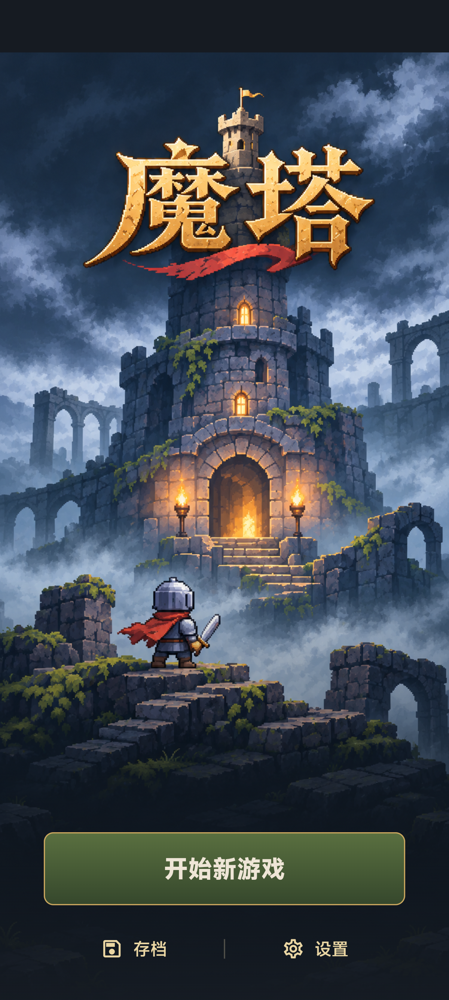
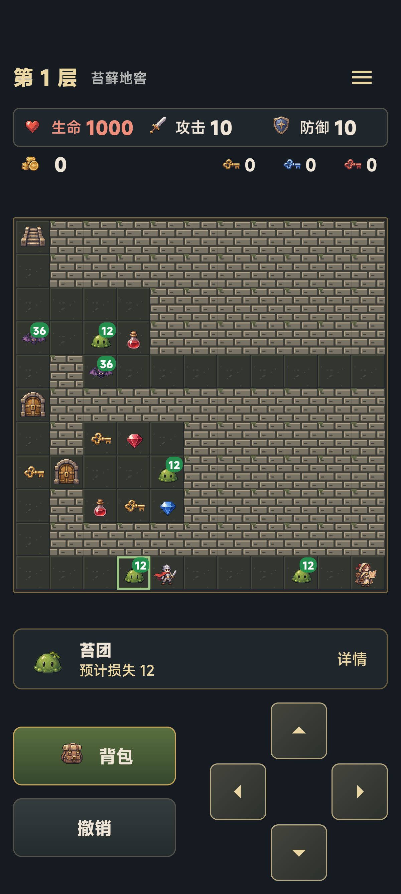
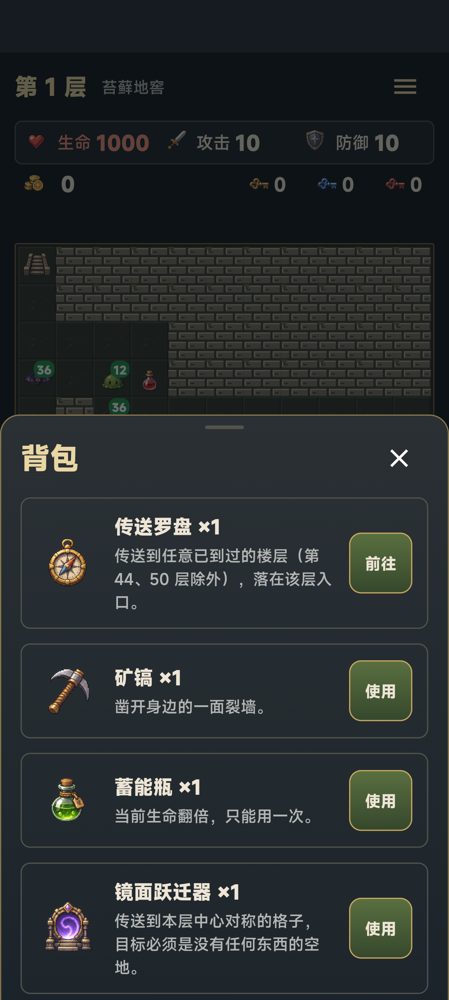

# 魔塔 · Flutter 移动版

基于《星穹塔》的 Flutter / Dart 安卓移植，保留 50 层地图与原版玩法，重新设计手机触摸界面和像素美术。游戏由 Flutter 直接渲染，离线运行，不依赖 WebView 或服务器。

## 原始版本来源

本项目的原始版本是 **[lnys/starTower — 星穹塔 Star Dome Tower](https://github.com/lnys/starTower)**，原项目使用 Vue 3 + Vite 实现。

- 移植基准：[e41439a3d7a72f6053b2e86f0019543bda65ca27](https://github.com/lnys/starTower/tree/e41439a3d7a72f6053b2e86f0019543bda65ca27)。
- 原版地图、怪物数值、战斗规则、道具效果、机关、剧情、结局及音序均来源于该提交。
- 原作者与贡献者的 MIT 版权声明完整保留在 [LICENSE](LICENSE)。本仓库是基于原项目的衍生移植。
- [reference/](reference/) 保留用于导出和对照的上游源码子集；新版界面、美术和音频响度调整属于本移植的改动。

感谢原作者及贡献者提供的游戏与开源代码。

## 游戏与手机操作

- 全部 50 层、5 个区域，固定 11×11 地图和可预判的战斗结果。
- 道具、装备、钥匙、祭坛、商人、机关、剧情和结局。
- 右侧方向键移动，支持长按；左侧背包和撤销。
- 点地图查看信息，地图下方显示战斗预估；存档、读档、设置收进菜单。
- 3 个手动存档和换层自动存档，支持覆盖安装保留进度。
- 新版像素角色、怪物、道具与地图材质，适配安全区域、横屏和大字体。

发布版本：**[1.0](https://github.com/yrbb/tower/releases/tag/v1.0)**，直接提供现有 APK（应用内部版本 1.1.3）。[下载 APK](https://github.com/yrbb/tower/releases/download/v1.0/mota-1.1.3.apk) · [更新记录](CHANGELOG.md)

## 游戏截图

| 首页 | 游戏界面 | 背包 |
| :---: | :---: | :---: |
|  |  |  |

以上为 Android 真机截图；背包使用测试道具展示界面，不代表新游戏初始物品。

## 运行与构建

使用过的工具链：Flutter 3.24.5 / Dart 3.5.4、JDK 17、Android SDK 35、NDK 26.3.11579264、Gradle 8.7。最低支持 Android 6.0（API 23）。

```sh
git clone https://github.com/yrbb/tower.git
cd tower
flutter pub get
flutter run -d <Android设备ID>
```

构建正常游戏入口的 APK：

```sh
flutter build apk --release --target=lib/main.dart
```

产物：`build/app/outputs/flutter-apk/app-release.apk`。当前 release 使用本机调试签名供试玩；正式发布需要配置持久化发布签名。覆盖更新请保留相同签名，不要卸载已有应用。

正式包名是 `cn.fastmini.star_tower`；debug/profile 使用独立的 `.debug` 包名，存档相互隔离。Web 仅作为预览入口，可用 `flutter run -d chrome` 启动。

## 项目结构

| 目录 | 内容 |
| --- | --- |
| `lib/game/` | 游戏数据接口、规则和引擎 |
| `lib/game_controller.dart` | 游戏动作、剧情、提示与存档时机 |
| `lib/ui/` | 首页、地图、触摸操作与弹层 |
| `lib/services/` | 音频、存储和长按连发 |
| `assets/` | 运行所需的美术、音频和地图数据 |
| `android/`、`web/` | 平台工程 |
| `test/`、`integration_test/` | 行为对照、界面与真机回归 |
| `tool/` | 数据导出、资源生成和校验脚本 |
| `reference/` | 固定上游提交的参考源码子集 |
| `docs/` | 开发说明和历史验证记录 |

## 开发说明与兼容性

[开发与测试命令](docs/DEVELOPMENT.md) · [验证记录](docs/VERIFICATION.md)

玩法以固定上游提交的实际代码为准，不调整地图、数值、奖励、道具次数、事件触发条件或通关条件。原版撞墙等无状态变化操作可能消耗上一条撤销记录的行为也保留。原菜单无效的撤销入口已移除，统一使用游戏界面的撤销按钮。

存档结构仍为原版版本 1；Android 使用应用私有目录 JSON，Web 使用 localStorage，不自动导入原网页游戏的存档。UI、美术、触摸入口和音频响度已按手机体验调整，不承诺与网页逐像素或逐音频样本一致。

最近两版按试玩反馈直接构建安装，尚未完成完整回归，也未人工完整通关 50 层；具体范围见验证记录。

## 许可证

[MIT](LICENSE)。引用和分发上游代码时，请保留原版权声明与许可证。
